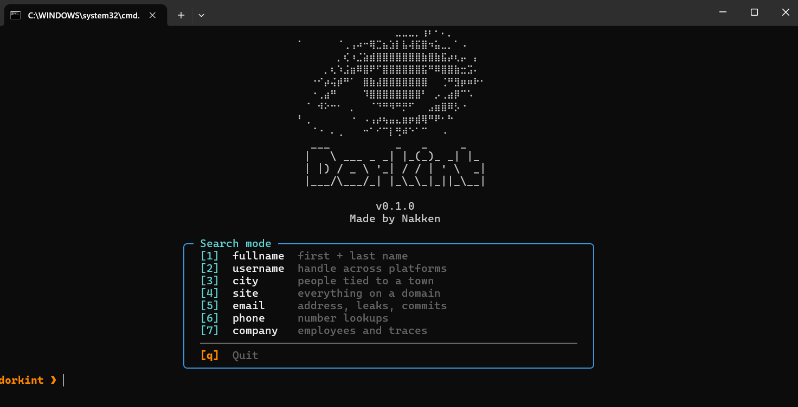
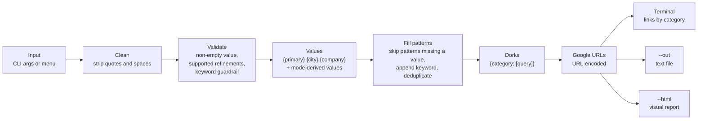

<div align="center">



# dorkint

**Google dorks for OSINT reconnaissance, generated in one command.**

Give it a name, a username, a domain... get ready-to-open search links, grouped by category.


</div>

---

## Why dorkint

- **Zero typing of operators**: pick a mode, enter a value, dorkint writes the dorks.
- **Nothing is searched**: it only builds URLs, you open them yourself (ctrl+click in the terminal).
- **Readable output**: category cards in the terminal, or a self-contained HTML report.
- **Two ways to use it**: flags for scripting, numbered menus for exploring.

> [!WARNING]
> Reserved for targets you are authorized to examine (yourself, a consenting person, a legitimate audit).
> No dork aimed at credentials, passwords or sensitive configuration files is generated, and the registry rejects them.
> Read [DISCLAIMER.md](DISCLAIMER.md) before use.

## Quick start

```bash
pip install .          # or: pipx install .   (Python 3.11+)
dorkint                # opens the interactive menu
```

Development install: `pip install -e .[dev]`.

## Interactive menu

Run `dorkint` alone (or `dorkint-tool`):

```text
        ╭─ Search mode ────────────────────────────────────────────────╮
        │  [1]  fullname       [2]  username      [3]  site            │
        │  [4]  email          [5]  phone         [6]  company         │
        │  ──────────────────────────────────────────────────────────  │
        │                  [0]  Info        [q]  Quit                  │
        ╰──────────────────────────────────────────────────────────────╯
```

| Key | Action |
|-----|--------|
| `1`-`6` | Pick a search mode, then enter the value, the refinements and a keyword (ENTER skips a field) |
| `0` | Show what dorkint does |
| `q` | Go back / quit |

After the results you can save the links, open the visual report in the browser, or run another search in the same mode.
The menu needs an interactive terminal.

## Command line

```bash
dorkint <mode> <value...> [--city CITY] [--company COMPANY] [--keyword WORD] [--out FILE] [--html FILE] [--force]
```

| Mode | Primary value | Refinements |
|------|---------------|-------------|
| `fullname` | "John Smith" | `--city`, `--company` |
| `username` | username | `--city`, `--company` |
| `site` | domain (`example.fr`) | `--company` |
| `email` | email address | `--city`, `--company` |
| `phone` | French number | `--city`, `--company` |
| `company` | company name or SIREN | `--city` |

Examples (fictional values):

```bash
dorkint fullname John Smith --city Lyon      # quotes optional
dorkint site example.fr
dorkint company "Acme" --out links.txt
dorkint username kalira --keyword minecraft  # keyword added to every dork
```

### Options

| Option | Effect |
|--------|--------|
| `--city`, `--company` | Refine the search with a known city or company |
| `--keyword WORD` | Add a quoted keyword to every dork to cross-reference information |
| `--out FILE` | Save the links to a file (refuses to overwrite without `--force`) |
| `--html FILE` | Write a visual report, open it in a browser |
| `--force` | Overwrite the `--out` / `--html` file |
| `--info` | List the dork patterns of each mode, without generating anything |

The plain output is a list of URLs, one per line, under `## Category` headers. Argument errors return exit code 2.

<details>
<summary><b>Visual report (<code>--html</code>)</b></summary>

One collapsible card per category with a link count. Each dork is a short button and the long Google URL stays hidden.
The interactive menu shows the same category cards in the terminal (labels are clickable links where the terminal supports it)
and can open the report directly.

</details>

<details>
<summary><b>Reading <code>--info</code></b></summary>

A bracketed suffix shows what a pattern requires: a refinement (`[--city]`) or a value derived from the primary value
(`[local, domain]`).

</details>

## How it works

From what you type to the links you get. Nothing is sent anywhere: dorkint only builds Google search URLs.



1. **Input.** `dorkint <mode> <value...>` or the interactive menu. The mode picks a set of dork patterns (`modes/*.py`).
2. **Clean and validate** (`builder.py`). Quotes are stripped, an empty value is refused, a refinement the mode does not use is refused,
   and a `--keyword` that looks like a credential search is rejected (`guardrails.py`).
3. **Values.** `{primary}` is your value between quotes; `--city` and `--company` fill `{city}` / `{company}`.
   A mode can derive more from the primary value: the domain and local part of an email, the 5 spellings of a phone number,
   or, for `fullname` with two words, the first and last name as separate terms (`"john" "doe"`, matched in any order).
   Field operators such as `intitle:` keep the exact phrase through `{phrase}`.
4. **Fill the patterns.** Each category lists patterns. A pattern whose values you did not give is skipped,
   the keyword is appended, and duplicates are dropped. Empty categories disappear.
5. **Output** (`output.py`, `visual.py`). Each dork becomes a Google URL. They are printed under `## Category` headers,
   optionally saved with `--out`, or rendered as a self-contained HTML report with `--html` (one card per category, live filter).

Example, `dorkint fullname john doe --city Lyon`:

| Step | Result |
|------|--------|
| Pattern | `site:linkedin.com/in {primary} {city}` |
| Values | `{primary}` = `"john" "doe"`, `{city}` = `"Lyon"` |
| Dork | `site:linkedin.com/in "john" "doe" "Lyon"` |
| URL | `https://www.google.com/search?q=site%3Alinkedin.com%2Fin+%22john%22+%22doe%22+%22Lyon%22` |

## Scope and limits

- **France only for now** (Infogreffe, societe.com, Pages Jaunes, data.gouv.fr, BODACC, Journal Officiel...).
  The dork patterns therefore contain French sites and French search words on purpose.
- The `phone` mode searches the 5 usual spellings of a French number; the `email` mode also searches the local part and the domain separately.
- Google results can be inaccurate or concern people with the same name.

## Contributing

Adding a mode takes one file, `src/dorkint/modes/<mode>.py`, holding a `CATEGORIES` dict of query patterns,
plus one line in `MODES` (`src/dorkint/modes/__init__.py`).
Details and an example in [AGENTS.md](AGENTS.md) ("Declaring a mode") and [CONTRIBUTING.md](CONTRIBUTING.md).

```bash
python -m pytest -q     # tests
ruff check .            # lint
mypy src                # types
```

## License

[MIT](LICENSE) — made by Nakken.
